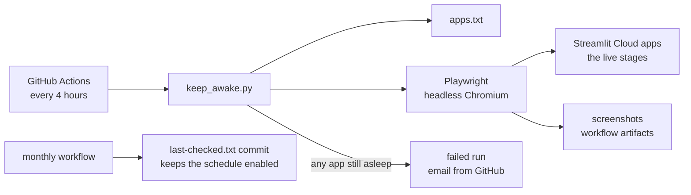
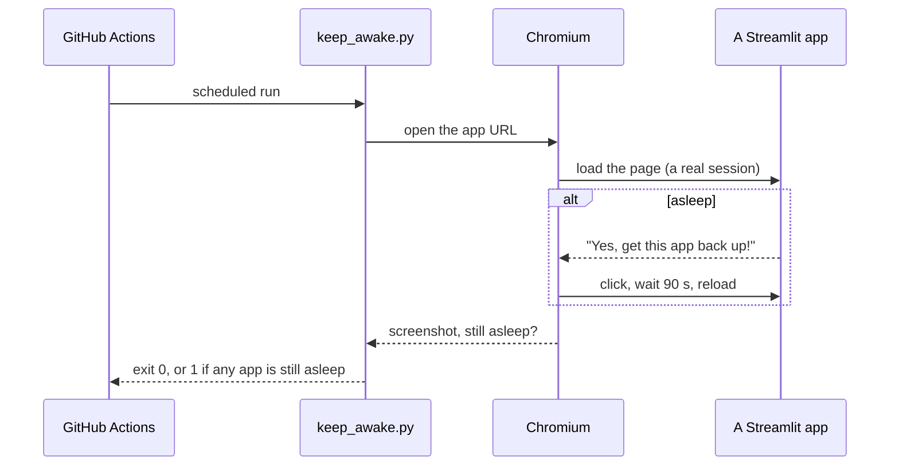

# streamlit-keep-awake

[](https://github.com/vamsialladev/streamlit-keep-awake/actions/workflows/ci.yml)
[](https://github.com/vamsialladev/streamlit-keep-awake/actions/workflows/keep-streamlit-awake.yml)

[](LICENSE)

**A scheduled browser visit that keeps my portfolio's free Streamlit apps awake, so a recruiter's first click
loads the app instead of a "wake up" screen.**

> Support tooling for a simulated client engagement (a fictional hotel group, synthetic data). It visits the live
> demos of the other stages; it has no data of its own and calls no AI model.

<!-- DEMO-VIDEO -->

**Try it live:** there's nothing to open; it runs in GitHub Actions. The
[latest runs](https://github.com/vamsialladev/streamlit-keep-awake/actions/workflows/keep-streamlit-awake.yml) show
it working, with a screenshot of each app as an artifact.

## At a glance

| | |
|---|---|
| **Problem** | Streamlit Community Cloud puts a free app to sleep after about 12 hours without visitors. The first visitor then sees a "wake up" button and waits about 30 seconds. |
| **Solution** | Every 4 hours a GitHub Actions job opens each app in a real headless browser, clicks the wake button if it's there, and fails the run (so GitHub emails me) if an app stays asleep. |
| **Measured quality** | 5 unit tests (the app list, awake, asleep, stays asleep). The schedule's run history is on the Actions tab. |
| **Cost** | $0: GitHub Actions minutes on a public repo, no model calls. |

## The problem

I send someone a link to a live demo. They click it on their phone between meetings, see "This app has gone to
sleep", and close the tab. A plain `curl` ping doesn't help: it fetches the static page, but Streamlit only counts a
real browser session as a visit, and only a browser can click the wake button.

## What it does

- Reads the app URLs from [`apps.txt`](apps.txt), one per line (`#` comments allowed).
- Opens each one in headless Chromium (Playwright). If it's awake, it stays long enough to count as a visit. If it's
  asleep, it clicks "get this app back up" and waits for it to start.
- Adds `?source=keepawake` to every visit. The hotel apps recognise it (the shared `bots` check in
  [hotel-ai-platform](https://github.com/vamsialladev/hotel-ai-platform)): the page loads, which keeps the app awake,
  but there's no model call, no log row, and the database isn't touched, so Neon's free tier can sleep.
- Visits apps three at a time, each in its own browser; the job stops after 40 minutes.
- Saves a screenshot of each app as a workflow artifact (kept 3 days).
- Fails the run if any app is still asleep or errors, so GitHub sends me an email.
- **Daily failure summary** (`.github/workflows/daily-failure-summary.yml`, 07:23 UTC): reads yesterday's rows in the
  shared ops log (one Neon database for every hotel app, read-only) and opens an issue, or posts to Slack if
  `SLACK_WEBHOOK_URL` is set, when an app's error rate was over 5% or it had requests but none succeeded. A day with
  no traffic is reported, not alarmed (hotel-ai-platform decision 6). Without the `OPS_DATABASE_URL` secret it's a
  dry run.
- A second workflow makes a tiny commit on the 1st of each month, because GitHub turns off scheduled workflows in a
  public repo after 60 days without activity.

## Architecture





## Results

The keep-awake workflow's run history is the result: each run lists every app as `[awake]` or `[asleep]` and
attaches its screenshots. The unit tests run on every push (`.github/workflows/ci.yml`).

## Business value

For a portfolio, the value is that the first click works. For a client pilot on free hosting, the same pattern
turns "the demo was down when the GM tried it" into a failed run and an email before anyone notices. The production
answer is paid always-on hosting; this is the free bridge until a pilot pays for it.

## Design at scale

| Topic | Design |
|---|---|
| **Model choice** | None. This is a scheduled browser visit. |
| **PII and tenant isolation** | It only opens public demo URLs; screenshots show synthetic data and are kept 3 days. |
| **10K → 1M users** | Not the problem this solves: at real traffic an app never sleeps. For many apps, split `apps.txt` across parallel jobs; for production, always-on hosting replaces this. |
| **Monitoring and alerting** | A failed run emails me; the stage 5 health check (hotel-ai-handoff) opens an issue when an app is down; the daily failure summary opens one when an app's error rate passes 5% or nothing succeeded. Keep-awake visits are labelled `source=keepawake` so they never count as traffic or errors. |
| **Failure modes and rollback** | An app that won't wake fails the run; GitHub disabling the schedule after 60 days is prevented by the monthly commit (and this README says how to re-enable it). Rollback: revert the commit. |

## Run locally

```powershell
git clone https://github.com/vamsialladev/streamlit-keep-awake.git
cd streamlit-keep-awake
py -3.12 -m venv .venv
.venv\Scripts\Activate.ps1
pip install -r requirements-dev.txt
python -m playwright install chromium
python keep_awake.py
python -m pytest
```

Add an app: one URL per line in `apps.txt`, then commit. No code changes needed.

If the workflow gets disabled anyway: Actions tab → **Keep Streamlit apps awake** → **Enable workflow** (or
`gh workflow enable keep-streamlit-awake.yml`), and the same for **Monthly keepalive commit**.

## Limitations and roadmap

- Every 4 hours, so an app can sleep for a short time after a restart before the next visit.
- It only wakes apps; it doesn't check that answers are right (the evals do that).
- Roadmap: post the run's summary to Slack, and skip an app for an hour after it failed to wake twice.

## Skills demonstrated

| Skill | Where it shows |
|---|---|
| Operational automation on free infrastructure | `.github/workflows/keep-streamlit-awake.yml`, `keepalive-commit.yml` |
| Knowing why the obvious fix fails | "The problem": a curl ping isn't a Streamlit visit |
| Testable code around a browser | `keep_awake.visit` with a fake page in `tests/` |

## Security

[SECURITY.md](SECURITY.md). No secrets are used. Decisions: [docs/DECISIONS.md](docs/DECISIONS.md) ·
[CHANGELOG](CHANGELOG.md)

## Author

Vamsi Alla · [vamsialla.com](https://vamsialla.com) · [LinkedIn](https://www.linkedin.com/in/vamsi-alla/) ·
[GitHub](https://github.com/vamsialladev)

## License

[MIT](LICENSE)
