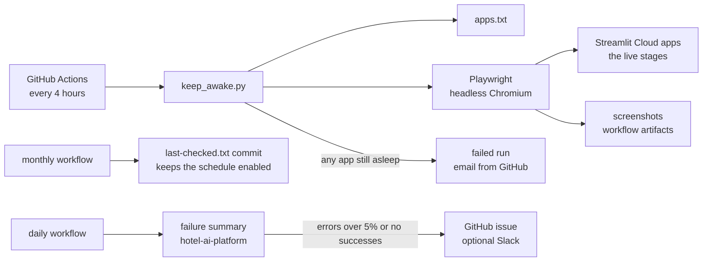
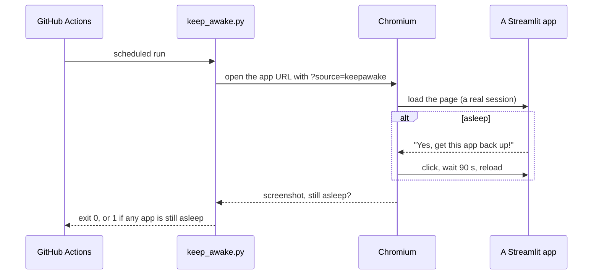

# Architecture

## System

## One visit

## Components

| Component | Job |
|---|---|
| `keep_awake.py` | Reads `apps.txt`, opens up to `KEEPAWAKE_PARALLEL` apps at once (default 3), clicks the wake button if needed, saves a screenshot, exits 1 if any app stays asleep |
| `apps.txt` | The app URLs, one per line |
| `.github/workflows/keep-streamlit-awake.yml` | The 4-hourly schedule, screenshots kept 3 days |
| `.github/workflows/keepalive-commit.yml` | A monthly commit so GitHub doesn't disable the schedule after 60 days |
| `.github/workflows/daily-failure-summary.yml` | Runs hotel-ai-platform's daily summary over the shared request log and opens an issue when something needs attention |

## Scaling path

The visit list grows by one line per app. Past a dozen or so apps, split `apps.txt` across a job matrix. With real
traffic an app never sleeps, so in production always-on hosting replaces this repo; the health check in
hotel-ai-handoff stays.
